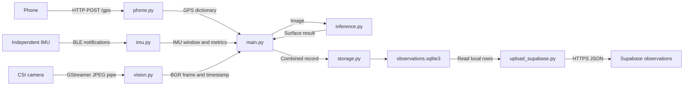

# Mobility-Aware-Accessibility-Map-rubik

Each camera frame can produce one database record. The phone supplies GPS only; a separate IMU supplies motion samples. `main.py` collects the frame, GPS and IMU window, runs surface inference, combines their outputs, and asks `storage.py` to save the record.

## Data flow



| File | Input -> processing -> output |
| --- | --- |
| `phone.py` | GPS JSON over HTTP -> validate fields and add receive times -> latest GPS dictionary. |
| `vision.py` | JPEG bytes from GStreamer stdout -> decode and keep the latest image in a queue -> BGR image with frame timestamps. |
| `imu.py` | IMU packets -> decode and buffer samples -> two-second window, slope and average vibration frequency. |
| `inference.py` | BGR image -> resize, normalize, run QNN/HTP and parse masks -> largest surface region's label and confidence. |
| `main.py` | Frame, GPS and module results -> check GPS timing/accuracy and combine fields -> record dictionary. |
| `storage.py` | Record dictionary -> parameterized SQLite INSERT -> saved row and record ID. Adds missing IMU columns to old databases. |
| `test_pipeline.py` | Run the full pipeline once, then inject five cases into the modules separately -> check their combined records -> console results and `test_observations.sqlite3`. |
| `upload_supabase.py` | Read SQLite rows -> convert boolean/JSON fields -> send batches to Supabase REST API and print upload counts. |

## Actual inputs and outputs: test case 1

The examples below show what each module receives and returns in stage 2, case 1. Numeric results are rounded; timestamps change each run.

### 1. Phone GPS

`inject_phone()` sends this JSON to `POST /gps`:

```json
{
  "latitude": 37.502789,
  "longitude": 126.9905,
  "accuracy_m": 2.9
}
```

`phone.py` validates latitude, longitude and accuracy. The HTTP response is `200` with `{"ok":true}`. `get_latest_gps()` returns these three fields plus `gps_time` (Pi receive time in UTC) and `gps_monotonic` (Pi monotonic clock for time comparisons).

### 2. Camera image

`inject_camera()` creates a uniform gray image, encodes it as JPEG, and writes the JPEG bytes into a pipe. The normal reader in `vision.py` decodes those bytes and queues the frame.

```text
Image shape: (24, 32, 3)
Data type: uint8
Every BGR pixel: [169, 169, 169]
```

`capture_frame()` returns a dictionary containing `image` (the BGR array), `frame_time` (UTC decode time), and `frame_monotonic` (Pi monotonic decode time). The image goes to inference; the frame time becomes the final record time.

### 3. IMU samples

`inject_imu()` generates 200 JSON packets at 100 samples per second. The first packet is:

```json
{
  "timestamp_s": 0.01,
  "ax": -0.927456,
  "ay": 0.0,
  "az": 9.843596,
  "gx": 0.0,
  "gy": 0.0,
  "gz": 0.0
}
```

`timestamp_s` increases by 0.01 seconds. `ax/ay/az` are acceleration including gravity, in m/s^2; `gx/gy/gz` are angular velocity, in rad/s. This case simulates a calibrated IMU with x forward and z upward, a -9.5% slope and a 15 Hz vibration. The test aligns the sample window to the camera frame.

The packets pass through `decode_packet()` and `add_sample()`. `get_window()` selects samples before the frame; `analyze_samples()` calculates:

```json
{
  "slope_percent": -9.5,
  "vibration_frequency_avg_hz": 15.0
}
```

Slope comes from mean gravity components during near-static motion. Average vibration frequency is the power-weighted mean from 1 to 40 Hz of the acceleration magnitude signal, with at least 80 samples/s. These values are calculated from the samples. The slope/frequency targets are parameters used to generate the test packets.

### 4. Surface inference

`inference.py` receives the BGR image from the camera. It resizes to 640x640, converts to RGB, divides by 255, and writes a float32 tensor shaped `[1, 3, 640, 640]`.

The test replaces QNN execution with `simulate_qnn()`. It creates zero-filled output tensors and sets these values before writing the `.raw` files:

```python
boxes[0, 0] = [320, 320, 640, 640]
class_scores[0, 0] = [0, 0.78, 0, 0, 0, 0, 0]
mask_coefficients[0, 0, 0] = 1.0
prototypes[0, :, :, 0] = 1.0
```

Class order is `blocks, cement, asphalt, urethane, soil_stone, other, damaged`. The second score selects `cement`. The box covers the full 640x640 input; the mask values create a full-image surface region.

The normal inference code reads the raw files, filters predictions and selects the largest mask. `analyze_image()` returns:

```json
{
  "surface_label": "cement",
  "surface_confidence": 0.78,
  "objects_supported": false,
  "objects": null
}
```

This prediction is supplied by the test. Recognition accuracy requires a real model and real images. Object detection is currently commented out.

### 5. Combine and save

`main.py` checks that GPS and frame times differ by at most 1 second and GPS accuracy is at most 10 meters. It passes the module outputs to:

```python
record = main.combine_data(frame, gps, result, imu_result)
record_id = storage.save_record(connection, record)
```

The frame supplies `record_time`; GPS supplies latitude/longitude; inference supplies the surface and reserved object fields; the IMU supplies slope/frequency. SQLite adds `id`. The saved row for this case is:

```json
{
  "id": 1,
  "record_time": "2026-10-13T13:22:36.034114Z",
  "latitude": 37.502789,
  "longitude": 126.9905,
  "surface_label": "cement",
  "surface_confidence": 0.78,
  "slope_percent": -9.5,
  "vibration_frequency_avg_hz": 15.0,
  "objects_supported": 0,
  "objects": null
}
```

SQLite stores `False` as `0` and `None` as `NULL`. GPS accuracy and monotonic timestamps are used for checks; the database stores the combined fields shown above.

## Test order and results

1. **Full pipeline:** `test_full_pipeline()` calls `main.main()` for one complete iteration. The fixed case uses GPS 37.5/127.0, asphalt at 0.9 confidence, 10% slope and 8 Hz vibration. Checks cover saved fields, migration of an old database, and resource cleanup.
2. **Module injection:** `test_module_integration()` runs five cases with seed 42. Each case checks the GPS, camera, IMU and inference outputs separately, combines them with `main.combine_data()`, saves the record and reads SQLite back to check all fields together.

Device input, model loading and QNN execution are simulated. HTTP reception, camera pipe reading, IMU calculations, image preprocessing, prediction parsing and SQLite operations run normally.

| Case | Surface | Input slope -> saved slope (%) | Input frequency -> saved average (Hz) | Result |
| --- | --- | --- | --- | --- |
| 1 | cement | -9.5 -> -9.5 | 15 -> 15.0 | PASS |
| 2 | cement | 2.4 -> 2.4 | 12 -> 12.0 | PASS |
| 3 | urethane | 7.4 -> 7.4 | 4 -> 4.0 | PASS |
| 4 | damaged | -9.8 -> -9.8 | 5 -> 5.0 | PASS |
| 5 | other | -9.0 -> -9.0 | 18 -> 18.0 | PASS |

The terminal shows each input, each module's output and the combined database record, followed by:

```text
STAGE 1: PASS - main loop, module connections, migration, save, and cleanup.
STAGE 2: PASS - 5/5 module integrations.
TEST RESULT: PASS - full pipeline + 5/5 module integrations.
```

## Run and inspect the database

Run the software test without connected hardware or configured model paths:

```bash
/home/ubuntu/test/.venv/bin/python -B test_pipeline.py
```

A successful test saves `test_observations.sqlite3` beside `test_pipeline.py`, replacing the previous test results. It contains the five stage-2 records with IDs 1 to 5. Open it with a SQLite viewer and run:

```sql
SELECT * FROM observations ORDER BY id;
```

For real collection, set `seg_model_path` in `inference.py` and run:

```bash
/home/ubuntu/test/.venv/bin/python main.py
```

Real records are saved to `observations.sqlite3` in the working directory. The phone sends GPS to the Pi's LAN IP on port 8000 at `/gps`.

The separate IMU model is still unknown. BLE address and notification UUID remain unset. Install `bleak` for BLE and adapt `decode_packet()` to the device protocol; Bluetooth serial needs a different transport. Enable `mounting_calibrated` after mounting and axis/sensor calibration. Missing, stale or unsuitable IMU data yields NULL metrics; uncalibrated mounting yields NULL slope. GPS and image collection can continue without the IMU.

## Upload to Supabase

The uploader runs separately: SQLite -> JSON batches -> HTTPS POST -> Supabase. It reads a snapshot of all local records without changing SQLite. Each run upserts by `(id, record_time)`, so sending the same records again updates them. A failure stops the upload; rerun after fixing the error. It uses the Python standard library.

| Function | Input -> output |
| --- | --- |
| `read_records(db_path)` | SQLite path -> list of record dictionaries; converts `objects_supported` to boolean and stored `objects` text to JSON. |
| `upload_records(records, supabase_url, api_key)` | Records and connection values -> sends batches of 100 to `/rest/v1/observations` -> uploaded count. |
| `main()` | Database argument and environment variables -> reads records, uploads, prints progress; exits with code 1 on error. |

Get the project URL from the Supabase dashboard's Data API/Connect screen and a **Secret key** (`sb_secret_...`) from **Settings > API Keys**. Store them as `SUPABASE_URL` and `SUPABASE_SECRET_KEY`. This key is for a private upload environment you control; keep it out of source code, GitHub and chat. A legacy `service_role` key can instead use `SUPABASE_SERVICE_ROLE_KEY`. New keys use the `apikey` header; legacy JWT keys also use `Authorization: Bearer` ([API keys](https://supabase.com/docs/guides/getting-started/api-keys)).

`SUPABASE_URL` accepts either `https://your-project.supabase.co` or `https://your-project.supabase.co/rest/v1/`. The uploader builds `/rest/v1/observations` once and prints the destination URL. HTTP 404 with `PGRST125` means the request path is invalid; check for a repeated `/rest/v1` or a table name appended to the configured base URL.

For a new destination table, run this once in the Supabase SQL Editor. The script expects these columns and the composite primary key. An existing table needs the same schema; `CREATE TABLE IF NOT EXISTS` leaves an existing schema unchanged.

```sql
CREATE TABLE IF NOT EXISTS public.observations (
    id bigint NOT NULL,
    record_time timestamptz NOT NULL,
    latitude double precision,
    longitude double precision,
    surface_label text,
    surface_confidence double precision,
    slope_percent double precision,
    vibration_frequency_avg_hz double precision,
    objects_supported boolean NOT NULL DEFAULT false,
    objects jsonb,
    PRIMARY KEY (id, record_time)
);
ALTER TABLE public.observations ENABLE ROW LEVEL SECURITY;
GRANT SELECT, INSERT, UPDATE ON public.observations TO service_role;
```

Enable the project's Data API with the `public` schema exposed. In a Bash terminal, set the URL, enter the key at the hidden prompt, and upload the five sample records:

```bash
export SUPABASE_URL="https://your-project.supabase.co"
read -rsp "Supabase secret key: " SUPABASE_SECRET_KEY
export SUPABASE_SECRET_KEY
printf '\n'
python3 upload_supabase.py test_observations.sqlite3
```

For collected observations, run `python3 upload_supabase.py` (default: `observations.sqlite3`). A successful sample upload prints `Uploaded 5/5 records.` and `Upload complete: 5 records sent to observations.` SQLite `0` becomes JSON `false`; `NULL` stays JSON `null`. The local IDs and all observation fields are preserved. `CONFIG` in the script sets the table, batch size and timeout. Query the destination with `SELECT * FROM public.observations ORDER BY record_time, id;`.
